# Manual Tecnico
# Park-Guard: Sistema Inteligente de Gestion y Seguridad de Parqueos

**Curso:** Arquitectura de Computadoras y Ensambladores 2  
**Ingeniero:** Gabriel Alejandro Diaz Lopez  
**Auxiliar:** Samuel Isai Muñoz Pereira  
**Grupo:** 13  
**Fecha:** 26 Febrero 2026

### Integrantes

| No. | Nombre | Carnet |
|-----|--------|--------|
| 1   |Ottoniel Fabricio Vásquez Pineda|202307820|
| 2   |Pablo Daniel Velásquez Hernández|202302232|
| 3   |Pablo Roberto García Sanun|202300448|
| 4   |Héctor Antonio Cardona Cos|202307354|
| 5   |Oscar David Padilla Vásquez|202103250|
| 6   |Diego Eduardo España Vásquez|202307716|

---

## Tabla de Contenidos

1. [Introduccion](#introduccion)
2. [Componentes y Hardware Utilizado](#componentes-y-hardware-utilizado)
3. [Arquitectura del Sistema](#arquitectura-del-sistema)
4. [Descripcion del Codigo por Modulos](#descripcion-del-codigo-por-modulos)
5. [Problemas Encontrados y Soluciones](#problemas-encontrados-y-soluciones)

---

## 1. Introduccion

El proyecto Park-Guard es un sistema automatizado de gestion de parqueos es nuestro proyecto del curso Arquitectura de Computadoras y Ensambladores 2. Este manual tecnico presenta la documentacion completa del sistema, incluyendo la descripcion de componentes, arquitectura de software, diagramas de conexion y protocolos de operacion.

El sistema implementa funcionalidades de control de acceso mediante RFID, monitoreo de espacios en tiempo real, control automatizado de talanqueras y un protocolo de emergencia activado por deteccion de gases peligrosos.


## 2. Componentes y Hardware Utilizado


<table>
  <tr>
    <td align="center"><b>1. Arduino Mega 2560</b><br>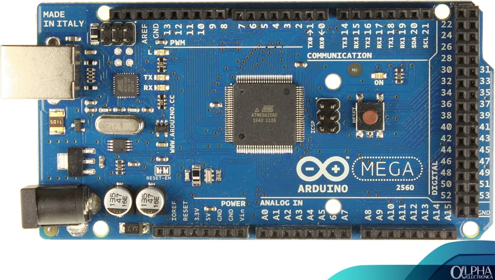</td>
    <td align="center"><b>2. Módulo RFID MFRC522</b><br>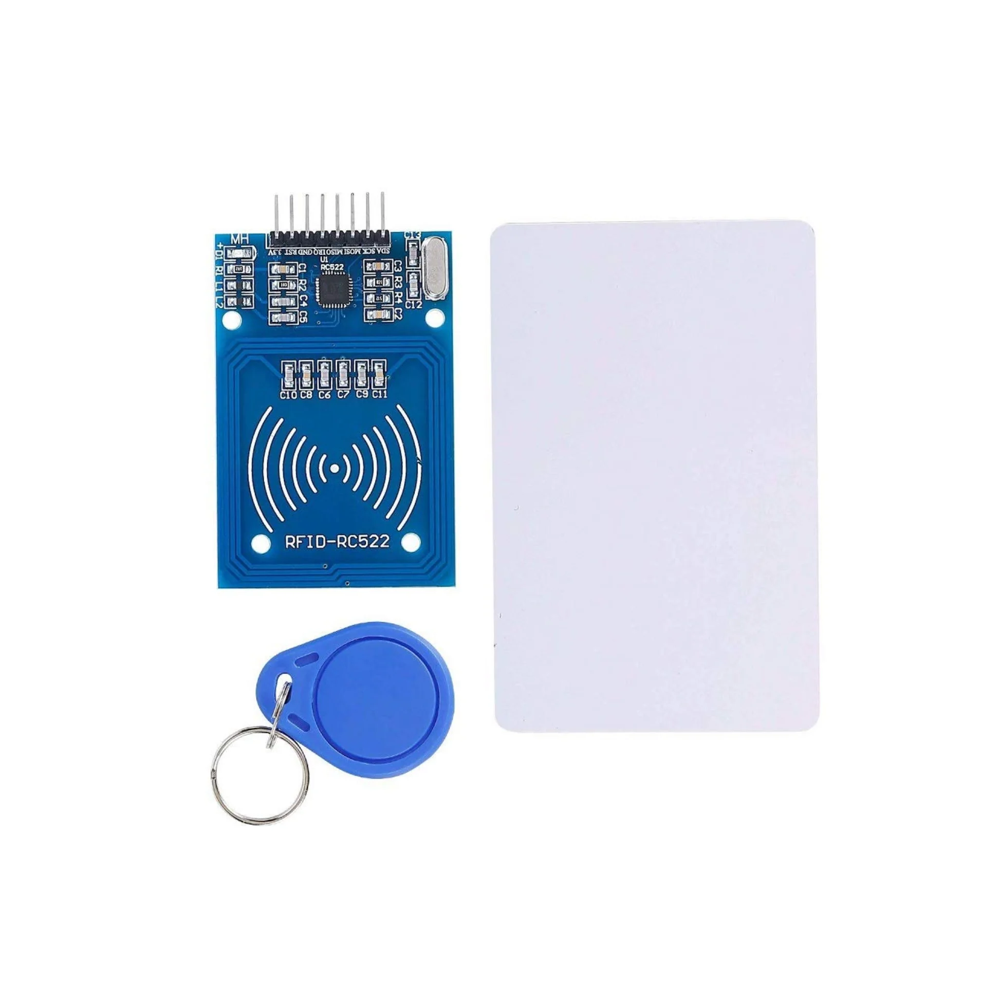</td>
    <td align="center"><b>3. Pantalla LCD 16x2 I2C</b><br>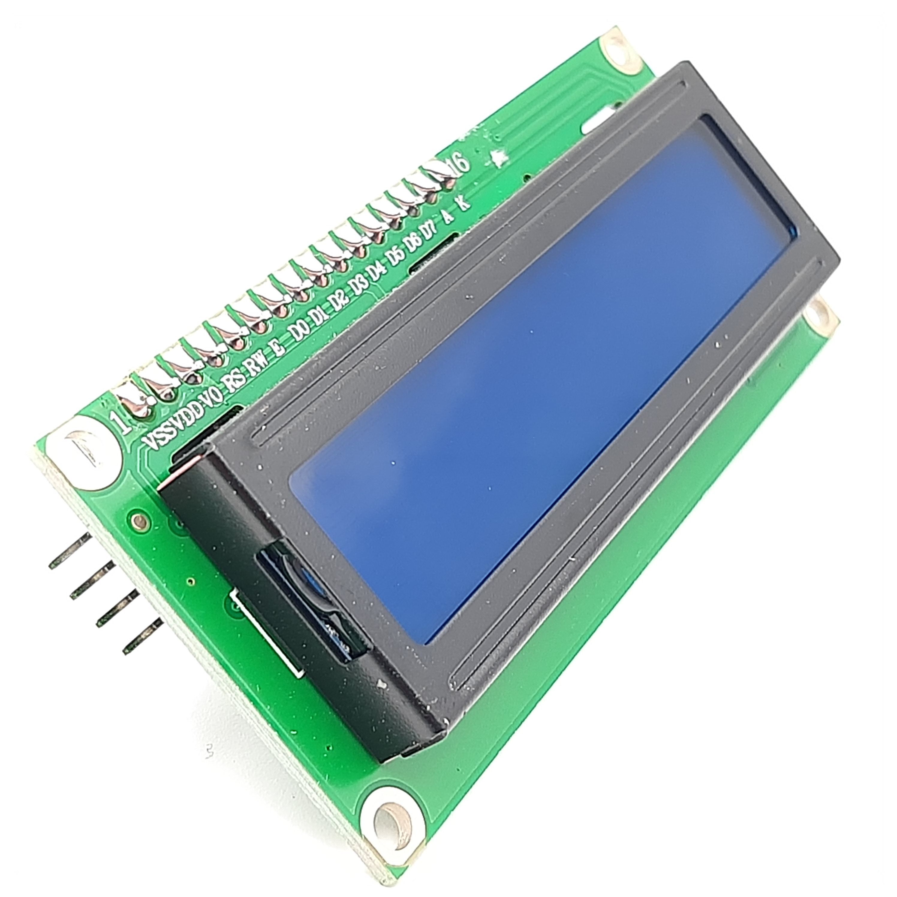</td>
    <td align="center"><b>4. Sensor Infrarrojo IR</b><br>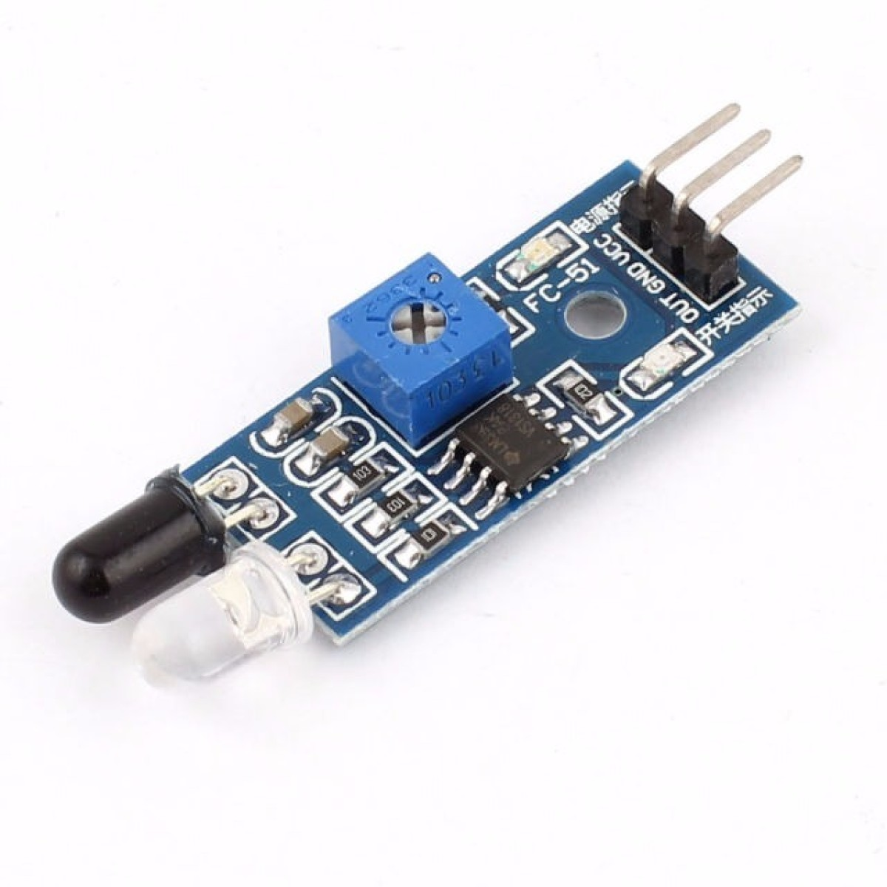</td>
  </tr>
  <tr>
    <td align="center"><b>5. Sensor Gas MQ-2</b><br>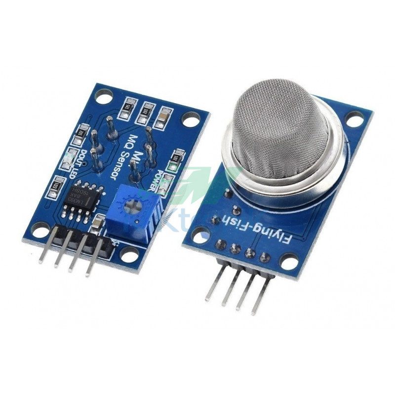</td>
    <td align="center"><b>6. Servomotor SG90 (entrada/salida)</b><br>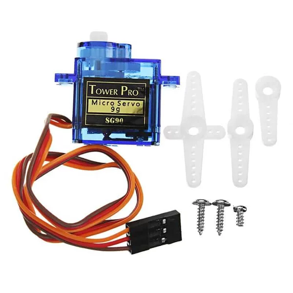</td>
    <td align="center"><b>7. Buzzer Activo 5V</b><br>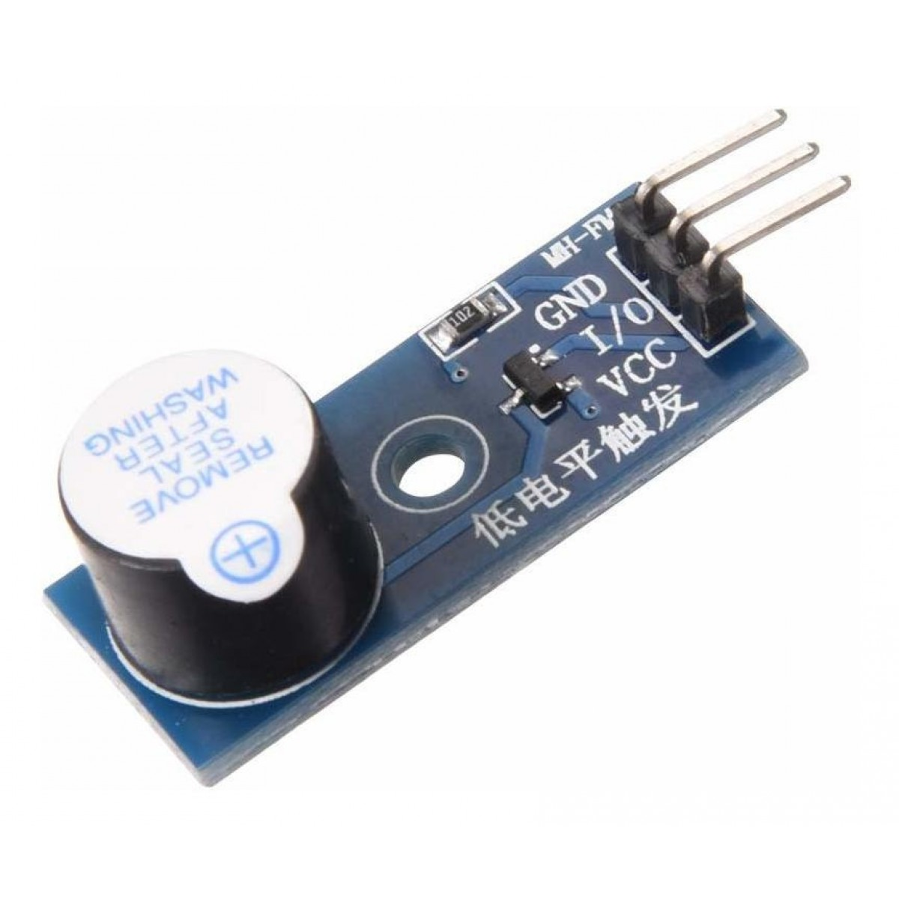</td>
    <td align="center"><b>8. Módulo Relé 1 Canal 5V</b><br>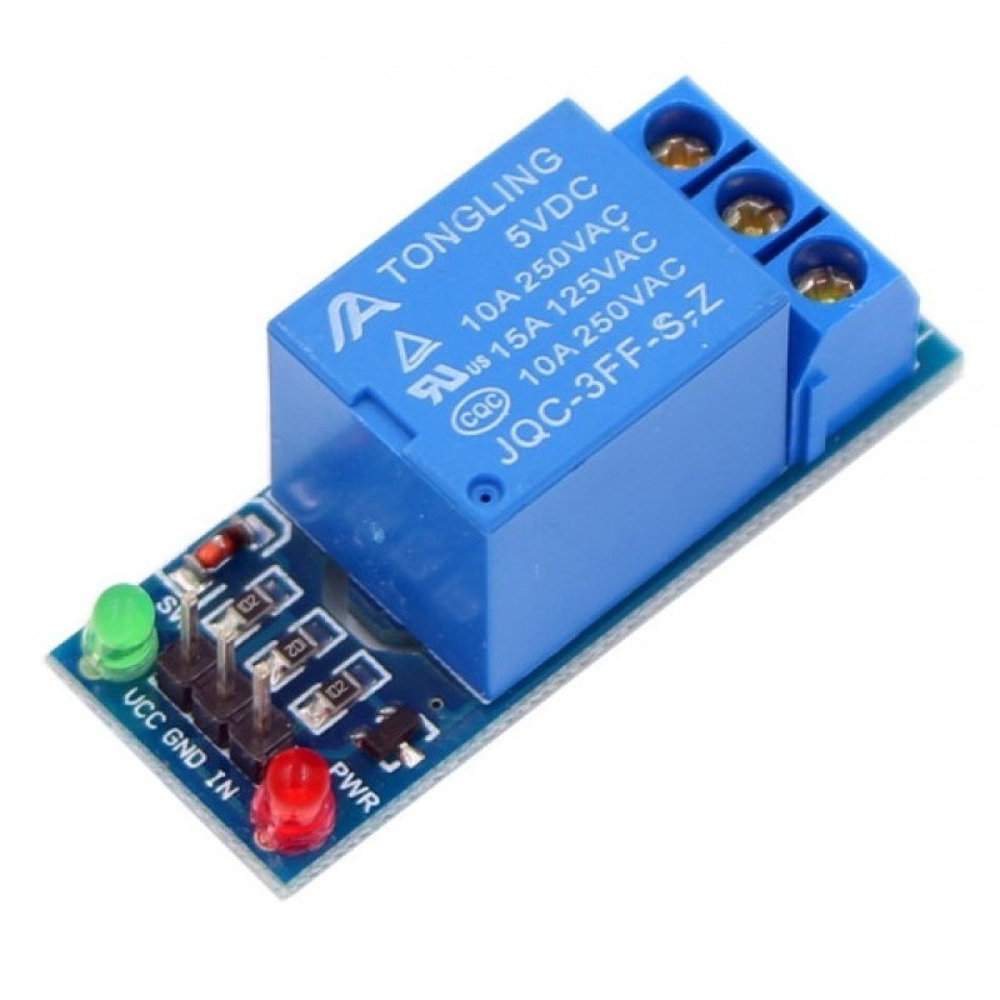</td>
  </tr>
  <tr>
    <td align="center"><b>9. Ventilador DC 5V</b><br>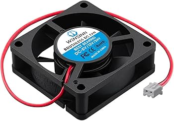</td>
    <td align="center"><b>10. LED RGB</b><br>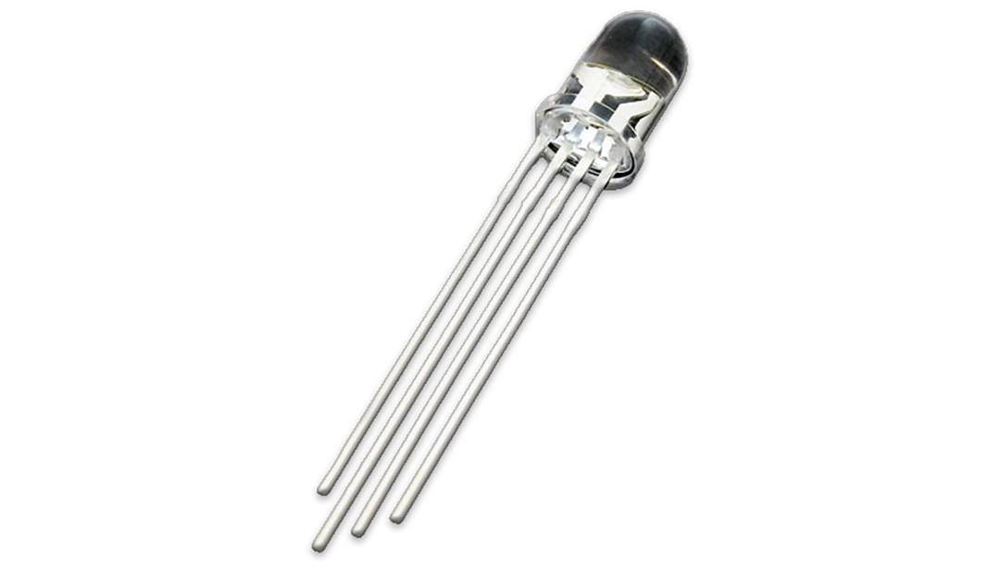</td>
    <td align="center"><b>11. Resistencia 220Ω</b><br>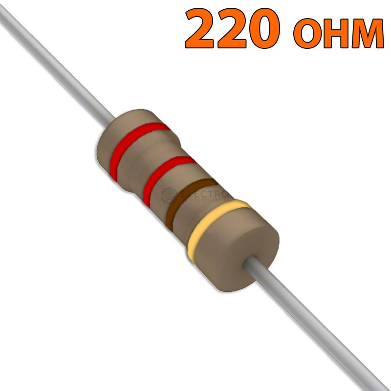</td>
    <td align="center"><b>12. Botón Pulsador</b><br>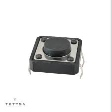</td>
  </tr>
  <tr>
    <td align="center"><b>13. Cables Dupont M-M, M-F</b><br>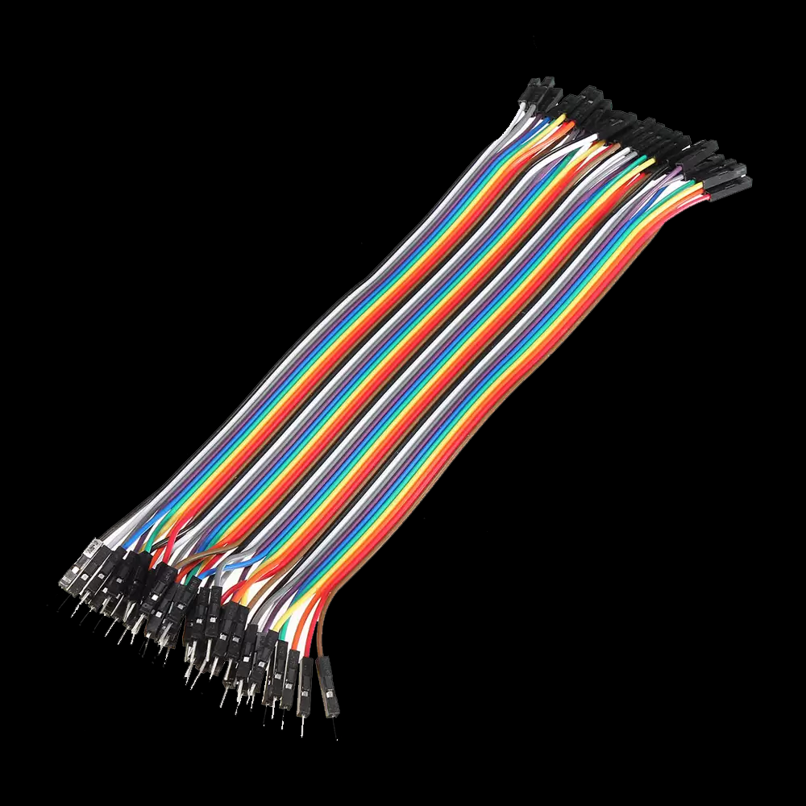</td>
    <td align="center"><b>14. Protoboard</b><br>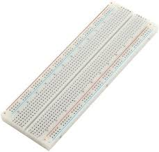</td>
    <td></td>
    <td></td>
  </tr>
</table>


### Lista Completa de Materiales y Conexiones

| Cantidad | Componente | Pin/Conexion Arduino | Referencia | Descripcion |
|----------|------------|----------------------|------------|-------------|
| 1 | Arduino Mega 2560 | - | U1 | Microcontrolador principal del sistema |
| 1 | Modulo RFID MFRC522 | SS=49, RST=48, MOSI=51, MISO=50, SCK=52 | U2 | Lectura de tarjetas de acceso via SPI |
| 1 | Pantalla LCD 16x2 I2C | SDA=20, SCL=21, Direccion 0x27 | LCD1 | Visualizacion de estados del sistema |
| 5 | Sensor Infrarrojo IR | 24, 25, 26, 27, 28 | S1-S5 | Deteccion de ocupacion de espacios |
| 1 | Sensor Gas MQ-2 | 19 (con interrupcion) | S6 | Deteccion de gases/humo para emergencias |
| 1 | Servomotor SG90 Entrada | 29 (PWM) | SV1 | Control de talanquera de entrada |
| 1 | Servomotor SG90 Salida | 30 (PWM) | SV2 | Control de talanquera de salida |
| 1 | Buzzer Activo 5V | 22 | BZ1 | Alarma sonora de emergencia |
| 1 | Modulo Rele 1 Canal 5V | 23 | RL1 | Control de ventilador |
| 1 | Ventilador DC 5V | Via Rele Pin 23 | M1 | Extraccion de gases en emergencia |
| 5 | LED RGB Catodo Comun | 31-32, 33-34, 35-36, 37-38, 39-40 | LED1-LED5 | Indicadores visuales (Rojo=ocupado, Verde=libre) |
| 10 | Resistencia 220Ω | En serie con LEDs | R1-R10 | Limitacion de corriente para LEDs |
| 1 | Boton Pulsador | 18 (INPUT_PULLUP) | BTN1 | Activacion manual de salida |
| 1 | Fuente 7-12V 2A | Jack Arduino | PWR1 | Alimentacion general del sistema |
| - | Cables Dupont M-M, M-F | - | - | Conexiones generales |
| - | Protoboard | - | - | Base de montaje |


- **Sensor MQ-2:** Configurado con interrupcion hardware en pin 19 (flanco FALLING) para respuesta inmediata ante gases
- **LEDs RGB:** Cada LED utiliza 2 pines (Rojo y Verde). Total: 10 pines digitales (31-40)
- **Comunicacion I2C:** Pines SDA=20 y SCL=21 para LCD
- **Comunicacion SPI:** Pines SS=49, MOSI=51, MISO=50, SCK=52 para RFID
- **Alimentacion:** Arduino Mega alimentado a 7-12V DC. Los servomotores pueden requerir fuente externa de 5V 2A para evitar caidas de voltaje

---

## 3. Arquitectura del Sistema

### 3.1 Diagrama de Bloques General

El sistema Park-Guard se estructura en cuatro modulos principales que interactuan con el microcontrolador Arduino Mega 2560:

```
                    ┌─────────────────────────────────────────┐
                    │                                         │
                    │      ARDUINO MEGA 2560                  │
                    │   (Controlador Principal)               │
                    │                                         │
                    └───┬────────┬────────┬────────┬──────────┘
                        │        │        │        │
        ┌───────────────┴───┐    │    ┌───┴────┐  └────────────┐
        │                   │    │    │        │               │
    ┌───▼──────┐    ┌──────▼────▼────▼───┐  ┌─▼────────┐  ┌──▼─────────┐
    │ MODULO   │    │     MODULO         │  │ MODULO   │  │  MODULO    │
    │ ENTRADA  │    │   MONITOREO        │  │ SALIDA   │  │ EMERGENCIA │
    └──────────┘    └────────────────────┘  └──────────┘  └────────────┘
         │                    │                   │              │
    ┌────▼─────┐         ┌────▼────┐         ┌───▼───┐     ┌────▼─────┐
    │ RFID     │         │ 5x IR   │         │Boton  │     │ Sensor   │
    │ MFRC522  │         │Sensores │         │Salida │     │  MQ-2    │
    └──────────┘         └─────────┘         └───────┘     └──────────┘
    ┌──────────┐         ┌─────────┐         ┌───────┐     ┌──────────┐
    │  Servo   │         │ 5x LEDs │         │ Servo │     │ Buzzer   │
    │ Entrada  │         │   RGB   │         │Salida │     │  Alarma  │
    └──────────┘         └─────────┘         └───────┘     └──────────┘
                         ┌─────────┐                       ┌──────────┐
                         │  LCD    │                       │ Rele +   │
                         │  16x2   │                       │Ventilador│
                         └─────────┘                       └──────────┘
```

**Flujo de datos:**
- **Entrada:** RFID lee tarjeta → Arduino valida → Servo abre talanquera (si hay espacio)
- **Monitoreo:** Sensores IR detectan ocupacion → Arduino actualiza → LEDs y LCD muestran estado
- **Salida:** Boton presionado → Arduino procesa → Servo abre talanquera de salida
- **Emergencia:** MQ-2 detecta gas → Interrupcion → Arduino activa protocolo (ventilador, buzzer, servos)

### 3.2 Descripcion de Modulos

#### Modulo de Entrada
- Lector RFID MFRC522
- Servomotor de entrada (Pin 29)
- Logica de validacion de tarjetas
- Control de apertura de talanquera

#### Modulo de Monitoreo
- 5 Sensores infrarrojos (Pines 24-28)
- 5 LEDs RGB de señalizacion
- Contador de espacios ocupados/libres
- Pantalla LCD para visualizacion

#### Modulo de Salida
- Boton de salida (Pin 18)
- Servomotor de salida (Pin 30)
- Maquina de estados para control de talanquera

#### Modulo de Emergencia
- Sensor MQ-2 (Pin 19 con interrupcion)
- Buzzer de alarma (Pin 22)
- Rele para ventilador (Pin 23)
- Protocolo de evacuacion automatica

---

## 4. Descripcion del Codigo por Modulos

**[AQUI VA UNA CAPTURA DE PANTALLA DEL ENTORNO DE DESARROLLO ARDUINO IDE]**

### 4.1 Librerias Utilizadas

```cpp
#include <LiquidCrystal_I2C.h>  // Control de pantalla LCD via I2C
#include <Servo.h>               // Control de servomotores
#include <MFRC522.h>             // Lectura de tarjetas RFID
#include <SPI.h>                 // Comunicacion SPI para RFID
```

**Descripcion de librerias:**

- **LiquidCrystal_I2C:** Permite la comunicacion con pantallas LCD que utilizan modulo I2C, simplificando las conexiones a solo 2 pines (SDA y SCL)
- **Servo:** Proporciona funciones para controlar servomotores, permitiendo establecer angulos de posicion
- **MFRC522:** Libreria especializada para modulos RFID MFRC522, permite lectura de tarjetas NFC/RFID
- **SPI:** Protocolo de comunicacion serial necesario para el modulo RFID

### 4.2 Definicion de Pines y Constantes

```cpp
//MQ2 
#define MQ2 19

//BUZZER
#define BUZZER 22

//RELE
#define VENTILADOR 23

//Boton de salida
#define BTN_Salida 18

//Infrarrojos
#define INFRA1 24 
#define INFRA2 25 
#define INFRA3 26 
#define INFRA4 27
#define INFRA5 28

//Servomotores
#define PIN_servoEntrada 29
#define PIN_servoSalida 30

//RFID
#define RST 48
#define SS 49
```

Utilizamos directivas `#define` para asignar nombres descriptivos a los pines fisico ya que esto mejora la legibilidad del codigo y facilita el mantenimiento, ya que si se requiere cambiar un pin, solo se modifica en este punto.

### 4.3 Declaracion de Variables Globales

```cpp
int ocupados = 0;
volatile bool emergenciaActiva = false;
int ultimo = -1;
```

**Analisis de variables importantes:**

- **ocupados:** Contador que almacena cuantos espacios estan ocupados en tiempo real
- **emergenciaActiva:** Variable tipo `volatile bool` ya que puede ser modificada por una interrupcion (ISR). La palabra clave `volatile` indica al compilador que no optimice esta variable
- **ultimo:** Almacena el ultimo estado de espacios libres mostrado en LCD para evitar actualizaciones innecesarias

### 4.4 Maquina de Estados Principal

El sistema implementa dos maquinas de estados independientes:

#### Estado de Entrada

```cpp
enum Estado {
  NORMAL,
  MOSTRANDO_MENSAJE,
  ABRIENDO_SERVO,
  ESPERANDO_ABIERTO,
  CERRANDO_SERVO
};

Estado estadoActual = NORMAL;
```
___

1. **NORMAL:** Estado de espera, el sistema monitorea sensores y espera eventos
2. **MOSTRANDO_MENSAJE:** Muestra mensaje de "Acceso concedido" por 1 segundo
3. **ABRIENDO_SERVO:** Abre la talanquera gradualmente de 0° a 90° (10ms por grado)
4. **ESPERANDO_ABIERTO:** Mantiene talanquera abierta permitiendo el paso
5. **CERRANDO_SERVO:** Cierra la talanquera de regreso a 0° (70ms por grado para movimiento mas lento)

___

#### Estado de Salida

```cpp
enum EstadoSalida {
  SALIDA_NORMAL,
  SALIDA_ABRIENDO,
  SALIDA_ESPERANDO,
  SALIDA_CERRANDO
};

EstadoSalida estadoSalida = SALIDA_NORMAL;
```
____
**Razon de uso:** Las maquinas de estados permiten control no bloqueante del sistema. En lugar de usar `delay()` que bloquea toda la ejecucion, se utilizan comparaciones de tiempo con `millis()` para ejecutar acciones asincronas.
____

### 4.5 Funcion Setup() - Inicializacion

```cpp
void setup() {
  Serial.begin(9600);

  pinMode(53, OUTPUT);
  digitalWrite(53, HIGH);

  //LCD 
  lcd.init(); 
  lcd.backlight();
  lcd.clear();

  //SPI + RFID
  SPI.begin();
  Mlector.PCD_Init(); 

  //LEDs RGB (los 5)
  for(int i = 0; i < 5; i++) {
    for(int j = 0; j < 2; j++) {
      pinMode(leds[i][j], OUTPUT);
    }
  }

  //Servos
  servoEntrada.attach(PIN_servoEntrada);
  servoSalida.attach(PIN_servoSalida);
  servoEntrada.write(0);
  servoSalida.write(0);

  //Sensores
  pinMode(MQ2, INPUT);
  attachInterrupt(digitalPinToInterrupt(MQ2), emergenciaISR, FALLING);

  //Boton de salida (Talanquera) 
  pinMode(BTN_Salida, INPUT_PULLUP);

  pinMode(INFRA1, INPUT_PULLUP);
  pinMode(INFRA2, INPUT_PULLUP);
  pinMode(INFRA3, INPUT_PULLUP);
  pinMode(INFRA4, INPUT_PULLUP);
  pinMode(INFRA5, INPUT_PULLUP);

  //Actuadores
  pinMode(BUZZER, OUTPUT);
  pinMode(VENTILADOR, OUTPUT);

  digitalWrite(BUZZER, LOW);
  digitalWrite(VENTILADOR, LOW);
}
```

**Analisis por bloques:**

1. **Comunicacion Serial:**
   ```cpp
   Serial.begin(9600);
   ```
   Inicializa comunicacion serial a 9600 baudios para debugging y monitoreo.

2. **Activacion de SPI en Mega:**
   ```cpp
   pinMode(53, OUTPUT);
   digitalWrite(53, HIGH);
   ```
   En Arduino Mega, el pin 53 debe estar en HIGH como OUTPUT para que el bus SPI funcione correctamente.

3. **Inicializacion LCD I2C:**
   ```cpp
   lcd.init(); 
   lcd.backlight();
   lcd.clear();
   ```
   Configura la pantalla LCD, activa la retroiluminacion y limpia la pantalla.

4. **Configuracion RFID:**
   ```cpp
   SPI.begin();
   Mlector.PCD_Init();
   ```
   Inicia el bus SPI y luego inicializa el lector RFID MFRC522.

5. **Configuracion de LEDs:**
   ```cpp
   for(int i = 0; i < 5; i++) {
     for(int j = 0; j < 2; j++) {
       pinMode(leds[i][j], OUTPUT);
     }
   }
   ```
   Doble bucle para configurar todos los pines de los 5 LEDs RGB (2 pines por LED: rojo y verde).

6. **Configuracion de Servomotores:**
   ```cpp
   servoEntrada.attach(PIN_servoEntrada);
   servoSalida.attach(PIN_servoSalida);
   servoEntrada.write(0);
   servoSalida.write(0);
   ```
   Asocia los servos a sus pines y los posiciona en 0° (cerrado).

7. **Configuracion de Interrupcion:**
   ```cpp
   attachInterrupt(digitalPinToInterrupt(MQ2), emergenciaISR, FALLING);
   ```
   Configura una interrupcion hardware en el pin 19. Cuando el sensor MQ-2 detecta gas, cambia de HIGH a LOW (flanco de bajada FALLING), llamando inmediatamente a la funcion `emergenciaISR()`.

8. **Configuracion de Entradas con Pull-Up:**
   ```cpp
   pinMode(BTN_Salida, INPUT_PULLUP);
   pinMode(INFRA1, INPUT_PULLUP);
   ```
   `INPUT_PULLUP` activa la resistencia pull-up interna del Arduino, manteniendo el pin en HIGH cuando no hay conexion y pasando a LOW cuando se activa.

### 4.6 Funcion Loop() - Ciclo Principal

#### 4.6.1 Monitoreo Serial para Debugging

```cpp
static unsigned long tiempoSerial = 0;
if(millis() - tiempoSerial >= 500){
  tiempoSerial = millis();

  Serial.print(" | MQ2 pin19: ");
  Serial.print(digitalRead(MQ2));
  if (digitalRead(MQ2) == HIGH) {
    Serial.print(" → GAS DETECTADO (deberia activar emergencia)");
  } else {
    Serial.print(" → sin gas");
  }
  Serial.print(" | EmergActiva: ");
  Serial.println(emergenciaActiva ? "ACTIVA" : "no");
  
  // Imprime estado de sensores infrarrojos
}
```

aqui se imprime cada 500ms el estado de todos los sensores al Monitor Serial. Es fundamental para debugging y verificacion del funcionamiento. Utiliza `static` para que la variable mantenga su valor entre llamadas a `loop()`.

#### 4.6.2 Lectura y Actualizacion de Sensores de Ocupacion

```cpp
ocupados = 0;

if (!emergenciaActiva) {
  if (digitalRead(INFRA1) == LOW) {
    setColor(0, HIGH, LOW);
    ocupados++;
  } else setColor(0, LOW, HIGH);

  if (digitalRead(INFRA2) == LOW) {
    setColor(1, HIGH, LOW);
    ocupados++;
  } else setColor(1, LOW, HIGH);
  
  // Se repite para INFRA3, INFRA4, INFRA5
}
```

____

- Los sensores infrarrojos entregan LOW cuando detectan un obstaculo (vehiculo presente)
- `setColor(ledNumero, rojo, verde)` controla los LEDs: `(HIGH, LOW)` = rojo (ocupado), `(LOW, HIGH)` = verde (libre)
- Se ejecuta solo si NO hay emergencia activa, ya que durante emergencia los LEDs parpadean en rojo
- El contador `ocupados` se calcula en cada ciclo para tener datos actualizados
____

#### 4.6.3 Actualizacion de Pantalla LCD

```cpp
int libres = 5 - ocupados;

if(estadoActual == NORMAL && libres != ultimo){
  lcd.clear();

  if(libres == 0){
    lcd.setCursor(3,0);
    lcd.print("CUPO LLENO");

    lcd.setCursor(0,1);
    lcd.print("ESPACIOS: 0   ");
  }else{
    lcd.setCursor(0,0);
    lcd.print("Libres: ");
    lcd.print(libres);
    lcd.print("   ");

    lcd.setCursor(0,1);
    lcd.print("Disponible  ");
  }

  ultimo = libres;
}
```

**Estrategia de actualizacion:**

- Solo actualiza cuando `libres != ultimo`, evitando parpadeos innecesarios de la pantalla
- Muestra mensaje especial cuando el parqueo esta completamente lleno
- `lcd.setCursor(columna, fila)` posiciona el cursor (LCD 16x2: 16 columnas, 2 filas)


#### 4.6.4 Maquina de Estados - Entrada

```cpp
switch(estadoActual){

  case MOSTRANDO_MENSAJE:
    if(millis() - tiempoEstado >= 1000){
      estadoActual = ABRIENDO_SERVO;
      tiempoServo = millis();
      anguloServo = 0;
    }
  break;

  case ABRIENDO_SERVO:
    if(millis() - tiempoServo >= 10){
      tiempoServo = millis();
      servoEntrada.write(anguloServo);
      anguloServo++;

      if(anguloServo >= 90){
        estadoActual = ESPERANDO_ABIERTO;
        tiempoEstado = millis();
      }
    }
  break;

  case ESPERANDO_ABIERTO:
    if(millis() - tiempoServo >= 70){
      tiempoServo = millis();
      servoEntrada.write(anguloServo);
      anguloServo--;

      if(anguloServo <= 0){
        estadoActual = NORMAL;
        ultimo = -1;
        servoEntrada.write(0);
      }
    }
  break;
}
```


1. **MOSTRANDO_MENSAJE:** Espera 1 segundo mostrando "Acceso concedido" antes de abrir talanquera
2. **ABRIENDO_SERVO:** Incrementa el angulo cada 10ms, creando movimiento suave de 0° a 90° (900ms total)
3. **ESPERANDO_ABIERTO:** Decrementa el angulo cada 70ms, cerrando lentamente de 90° a 0° (mas lento que apertura para simular realismo)

**Tecnica de control no bloqueante:**

En lugar de:
```cpp
delay(1000);  // BLOQUEA TODO EL SISTEMA
```

Se usa:
```cpp
if(millis() - tiempoEstado >= 1000){  // NO BLOQUEANTE
  // Ejecuta accion
}
```

Esto permite que el sistema siga leyendo sensores, atendiendo interrupciones y respondiendo a eventos mientras se ejecutan las animaciones de los servos.

#### 4.6.5 Lectura de Tarjeta RFID

```cpp
if(estadoActual == NORMAL && !emergenciaActiva){
  if(Mlector.PICC_IsNewCardPresent() && Mlector.PICC_ReadCardSerial()){
    for(byte i=0; i<Mlector.uid.size; i++){
      lectura[i] = Mlector.uid.uidByte[i];
    }

    if(comprobacion(lectura, tarjeta)){
      if(libres > 0){
        lcd.clear();
        lcd.setCursor(0, 0);
        lcd.print("Acceso concedido");
        lcd.setCursor(4, 1);
        lcd.print("Grupo 13");

        estadoActual = MOSTRANDO_MENSAJE;
        tiempoEstado = millis();

      } else{
        lcd.clear();
        lcd.setCursor(0,0);
        lcd.print("Parqueo lleno");
        delay(1500);
        lcd.clear();
        ultimo = -1;
      }

    } else{
      lcd.clear();
      lcd.setCursor(0, 0);
      lcd.print("Tarjeta invalida");
      delay(1500);
      ultimo = -1;
    }

    Mlector.PICC_HaltA();
    Mlector.PCD_StopCrypto1();
  }
}
```

**Analisis de seguridad:**

1. Solo lee tarjetas cuando `estadoActual == NORMAL` (no durante operacion de talanquera)
2. No permite acceso si hay emergencia activa
3. Compara el UID leido contra una tarjeta autorizada predefinida:
   ```cpp
   byte tarjeta[4] = {0xB9, 0x1E, 0x19, 0xB4};
   ```
4. Verifica disponibilidad de espacios antes de conceder acceso
5. `Mlector.PICC_HaltA()` detiene la comunicacion con la tarjeta para evitar lecturas multiples


### 4.7 Funcion comprobacion() - Validacion de Tarjeta

```cpp
boolean comprobacion(byte lectura[], byte tarjeta[]){
  for(byte x=0; x<Mlector.uid.size; x++){
    if(lectura[x] != tarjeta[x]){
      return false;
    }
  }
  return true;
}
```

**Explicacion:** Compara byte por byte el UID de la tarjeta leida con la tarjeta autorizada. Si todos los bytes coinciden, retorna `true`. Si encuentra una diferencia, inmediatamente retorna `false`.

### 4.8 Funcion setColor() - Control de LEDs RGB

```cpp
void setColor(int ledNumero, bool rojo, bool verde){
  digitalWrite(leds[ledNumero][0], rojo);
  digitalWrite(leds[ledNumero][1], verde);
}
```

**Tabla de estados:**

| Rojo | Verde | Color Resultante | Significado |
|------|-------|------------------|-------------|
| HIGH | LOW   | Rojo             | Espacio ocupado |
| LOW  | HIGH  | Verde            | Espacio libre |
| LOW  | LOW   | Apagado          | Usado en parpadeo de emergencia |


### 4.9 Funcion activarEmergencia() - Protocolo de Emergencia

```cpp
void activarEmergencia() {

  static bool emergenciaEnCurso = false;
  static unsigned long ultimoParpadeo = 0;  

  if (emergenciaActiva && !emergenciaEnCurso) {
    digitalWrite(VENTILADOR, HIGH);
    servoEntrada.write(90);
    servoSalida.write(90);

    lcd.clear();
    lcd.setCursor(0,0);
    lcd.print("!!! EMERGENCIA !!!");
    lcd.setCursor(2,1);
    lcd.print("EVACUAR AREA");

    emergenciaEnCurso = true;
    lastBeep = millis();
    ultimoParpadeo = millis();  
  }
```

**Acciones inmediatas al detectar emergencia:**

1. **Activa ventilador:** `digitalWrite(VENTILADOR, HIGH)` energiza el rele que enciende el ventilador para extraer gases
2. **Abre ambas talanqueras:** `servoEntrada.write(90)` y `servoSalida.write(90)` facilitan evacuacion rapida
3. **Muestra alerta en LCD:** Mensaje claro de evacuacion
4. **Activa bandera:** `emergenciaEnCurso = true` para ejecutar codigo de emergencia solo una vez

#### 4.9.1 Alarma Sonora de Emergencia

```cpp
if (emergenciaActiva) {

  static int tonoActual = 500;
  static bool subiendo = true;

  if (millis() - lastBeep >= 8) {
    lastBeep = millis();

    tone(BUZZER, tonoActual);

    if (subiendo) {
      tonoActual += 6;
      if (tonoActual >= 1400) subiendo = false;
    } else {
      tonoActual -= 6;
      if (tonoActual <= 500) subiendo = true;
    }
  }
}
```

**Efecto de sirena:**


- Se actualiza cada 8ms para transicion suave
- Utiliza la funcion `tone(pin, frecuencia)` de Arduino


#### 4.9.2 Parpadeo de LEDs de Emergencia

```cpp
if (millis() - ultimoParpadeo > 300) {
  static bool estadoLED = false;
  estadoLED = !estadoLED;
  for(int i = 0; i < 5; i++) {
    if (estadoLED) {
      setColor(i, HIGH, LOW);   //Rojo
    } else {
      setColor(i, LOW, LOW);    //Apagado
    }
  }
  ultimoParpadeo = millis();
}
```

**Patron de parpadeo:**

- Todos los LEDs parpadean en rojo sincronizados
- 300ms encendidos en rojo, 300ms apagados
- Crea efecto visual de alerta que capta atencion inmediata

#### 4.9.3 Desactivacion de Emergencia

```cpp
if (emergenciaActiva && digitalRead(MQ2) == HIGH) {
  emergenciaActiva = false;
  emergenciaEnCurso = false;

  noTone(BUZZER);
  digitalWrite(VENTILADOR, LOW);
  servoEntrada.write(0);
  servoSalida.write(0);
  lcd.clear();
  ultimo = -1;
}
```

**Condicion de finalizacion:**

- Cuando el sensor MQ-2 vuelve a HIGH (no detecta gas)
- Desactiva todos los actuadores de emergencia
- Reinicia el sistema al estado NORMAL
- `ultimo = -1` fuerza actualizacion completa de pantalla LCD

### 4.10 Funcion emergenciaISR() - Rutina de Servicio de Interrupcion

```cpp
void emergenciaISR() {
  emergenciaActiva = true;
}
```

**Diagrama de flujo ISR:**

```
Sensor MQ-2 detecta gas → Pin 19 va a LOW (FALLING) 
                       ↓
                Interrupcion Hardware
                       ↓
           Pausa ejecucion de loop()
                       ↓
              Ejecuta emergenciaISR()
                       ↓
        emergenciaActiva = true
                       ↓
        Retorna a loop() donde estaba
                       ↓
     En siguiente iteracion, loop() detecta
     emergenciaActiva == true y llama activarEmergencia()
```

### 4.11 Funcion btnSalida() - Control de Talanquera de Salida

```cpp
void btnSalida(){
  static unsigned long ultimoPresion = 0;
  static bool botonAnterior = HIGH;

  bool botonActual = digitalRead(BTN_Salida);

  if (botonActual == LOW && botonAnterior == HIGH && millis() - ultimoPresion > 400) {
    ultimoPresion = millis();

    if (estadoSalida == SALIDA_NORMAL && !emergenciaActiva) {
      estadoSalida = SALIDA_ABRIENDO;
      tiempoSalida = millis();
      anguloSalida = 0;
      Serial.println("BOTON PRESIONADO - Iniciando apertura salida");
    }
  }

  botonAnterior = botonActual;
```

**Tecnicas implementadas:**

1. **Deteccion de flanco:** Solo actua cuando `botonActual == LOW && botonAnterior == HIGH` (transicion de no presionado a presionado)
2. **Debounce por software:** `millis() - ultimoPresion > 400` evita multiples detecciones por rebotes mecanicos del boton (400ms de espera minima)
3. **Variables estaticas:** Mantienen estado entre llamadas de la funcion

**Maquina de estados de salida:**

```cpp
switch (estadoSalida) {
  case SALIDA_ABRIENDO:
    if (millis() - tiempoSalida >= 10) {
      tiempoSalida = millis();
      servoSalida.write(anguloSalida);
      anguloSalida++;

      if (anguloSalida >= 90) {
        estadoSalida = SALIDA_ESPERANDO;
        tiempoSalida = millis();
      }
    }
    break;

  case SALIDA_ESPERANDO:
    if (millis() - tiempoSalida >= 2000) {
      estadoSalida = SALIDA_CERRANDO;
      tiempoSalida = millis();
      anguloSalida = 90;
    }
    break;

  case SALIDA_CERRANDO:
    if (millis() - tiempoSalida >= 10) {
      tiempoSalida = millis();
      servoSalida.write(anguloSalida);
      anguloSalida--;

      if (anguloSalida <= 0) {
        estadoSalida = SALIDA_NORMAL;
      }
    }
    break;
}
```

**Tiempos del ciclo:**

- Apertura: 90 grados × 10ms = 900ms
- Espera: 2000ms (2 segundos)
- Cierre: 90 grados × 10ms = 900ms
- Total: ~3.8 segundos por ciclo completo


## 5. Problemas Encontrados y Soluciones

### 5.1 Problema: Lecturas Multiples de RFID

**Descripcion:** Al acercar la tarjeta RFID, se detectaban multiples lecturas, causando que la talanquera intentara abrirse varias veces.

**Causa:** El modulo RFID continua leyendo mientras la tarjeta esta cerca del lector.

**Solucion Implementada:**
```cpp
Mlector.PICC_HaltA();          // Detiene comunicacion con tarjeta
Mlector.PCD_StopCrypto1();     // Detiene encriptacion
```

Estas dos lineas al final de la lectura aseguran que la tarjeta no se vuelva a leer hasta que se retire y acerque nuevamente.

### 5.2 Problema: Rebotes del Boton de Salida

**Descripcion:** Al presionar el boton, se detectaban multiples pulsaciones por rebotes mecanicos.

**Causa:** Los botones fisicos generan ruido electrico al cerrar contactos.

**Solucion Implementada:**
```cpp
// Debounce por software
static unsigned long ultimoPresion = 0;
if (botonActual == LOW && botonAnterior == HIGH && millis() - ultimoPresion > 400) {
  ultimoPresion = millis();
  // Ejecuta accion
}
```

FIltro temporal de 400ms que ignora pulsaciones muy rapidas (rebotes).

### 5.3 Problema: Parpadeo del LCD

**Descripcion:** La pantalla LCD parpadeaba constantemente, causando efectos visuales molestos.

**Causa:** El codigo llamaba `lcd.clear()` en cada iteracion del loop, incluso cuando la informacion no cambiaba.

**Solucion Implementada:**
```cpp
int ultimo = -1;  // Guarda ultimo estado mostrado

if(estadoActual == NORMAL && libres != ultimo){
  lcd.clear();
  // Actualiza pantalla
  ultimo = libres;
}
```

Solo actualiza cuando el numero de espacios libres cambia.

### 5.4 Problema: Servos se Mueven Bruscamente

**Descripcion:** Los servomotores se movian de golpe de 0° a 90°, creando movimiento poco realista y generando ruido.

**Causa:** Uso de comandos directos sin transiciones:
```cpp
// Malo
servoEntrada.write(90);  // Salto inmediato
```

**Solucion Implementada:**
```cpp
// Bueno: Movimiento gradual
if(millis() - tiempoServo >= 10){
  tiempoServo = millis();
  servoEntrada.write(anguloServo);
  anguloServo++;
  if(anguloServo >= 90) estadoActual = SIGUIENTE;
}
```

Incrementos de 1° cada 10ms crean movimiento suave y realista.

### 5.5 Problema: Sensor MQ-2 No Activaba Interrupcion

**Descripcion:** El sensor de gas no activaba el protocolo de emergencia.

**Causa:** Pin 53 de Arduino Mega no configurado correctamente, afectando interrupciones.

**Solucion Implementada:**
```cpp
pinMode(53, OUTPUT);
digitalWrite(53, HIGH);
```

En Arduino Mega, el pin 53 debe estar en HIGH para operacion correcta de SPI e interrupciones.

### 5.6 Problema: Direccion I2C del LCD Incorrecta

**Descripcion:** La pantalla LCD no mostraba nada, retroiluminacion encendida pero sin texto.

**Causa:** Direccion I2C incorrecta en el codigo.

**Diagnostico realizado:**
```cpp
// Escaner I2C (codigo de prueba usado)
Wire.begin();
Wire.beginTransmission(direccion);
byte error = Wire.endTransmission();
if (error == 0) Serial.println("Dispositivo encontrado en: " + direccion);
```

**Solucion:** Cambiar de `0x3F` (comun en algunos modulos) a `0x27` (direccion real del modulo usado):
```cpp
LiquidCrystal_I2C lcd(0x27,16,2);  // Direccion correcta
```


## Anexos

### Anexo A: Codigo Fuente Completo

El codigo fuente completo se encuentra en:
```
/Codigo_Proyecto1_G13/Codigo_Proyecto1_G13.ino
```

### Anexo B: Archivo de Simulacion Proteus

El diagrama esquematico y simulacion se encuentran en:
```
/DiagramaEsquematico/ACE2_1S26_13.pdsprj
```

---


