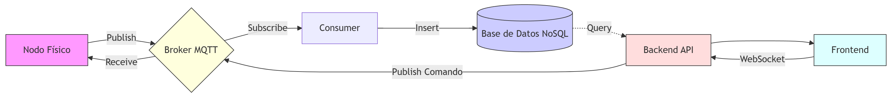

# Manual Tecnico
# Park-Guard 2.0

**Curso:** Arquitectura de Computadoras y Ensambladores 2  
**Ingeniero:** Gabriel Alejandro Diaz Lopez  
**Auxiliar:** Samuel Isai Muñoz Pereira  
**Grupo:** 13  
**Fecha:** 28 Marzo 2026

### Integrantes

| No. | Nombre | Carnet |
|-----|--------|--------|
| 1   |Ottoniel Fabricio Vásquez Pineda|202307820|
| 2   |Pablo Daniel Velásquez Hernández|202302232|
| 3   |Pablo Roberto García Sanun|202300448|
| 4   |Héctor Antonio Cardona Cos|202307354|
| 5   |Oscar David Padilla Vásquez|202103250|
| 6   |Diego Eduardo España Vásquez|202307716|

---

## Tabla de Contenidos

1. [Introduccion](#introduccion)
2. [Objetivos](#Objetivos) 
3. [Alcance del Proyecto](#Alcande-del-Proyecto)
4. [Arquitectura del Sistema](#arquitectura-del-sistema)
5. [Documentación de Topics MQTT](#Documentación-de-Topics-MQTT)
6. [Diseño de Base de sDatos NoSQL](#Diseño-de-Base-de-sDatos-NoSQL)
7. [Diseño de Dashboard](#Diseño-de-Dashboard)
8. [Explicación del Flujo Completo](#Explicación-del-Flujo-Completo)

---

## 1. Introduccion

El proyecto Park-Guard es un sistema automatizado de gestion de parqueos, es nuestro proyecto del curso Arquitectura de Computadoras y Ensambladores 2. Este manual tecnico presenta la documentacion completa del sistema, incluyendo la descripcion de componentes, arquitectura de software, diagramas de conexion y protocolos de operacion.

El sistema implementa funcionalidades de control de acceso mediante RFID, monitoreo de espacios en tiempo real, control automatizado de talanqueras y un protocolo de emergencia activado por deteccion de gases peligrosos. También se incluye lo que es trabajar con bases de datos que sería con MongoDB, también se incluye lo que Docker, creando imagenes y también consumer, para trabajar de mejor manera y ordenada.


---

## 2. Objetivos

* **Objetivo General:** Desarrrollar un sistema IoT distribuido para la gestión inteligente de parqueos, integrando hardware físico con uan arquitectura orientada a eventos, contenedores Docker y visualización en tiempo real.

* **Objetivos específicos:** 
    - Implementar una comunicación bidireccional entre el nodo físico y el sistema web mediante el protocolo MQTT.
    - Gestionar de forma dinámica los usuarios y sus tarjetas RFID desde una base de datos NoSQL, eliminando la validación local en el microcontrolador.
    - Visualizar el estado del parqueo y eventos operativos en un dashboard interactivo actualizado por WebSockets.
    - Desplegar todos los servicios de software de forma desacoplada utilizando contenedores Docker y orquestación con Docker Compose.

---

## 3. Alcande del Proyecto

El sistema abarca desde la detección física de eventos hasta el análisis de datos en la web:

* **Control de Acceso:** Validación de tarjetas RFID contra la base de datos y control de talenqueras.

* **Monitoreo Ambiental:** Detección de gas/humo y activación automática de ventilzación y alarmas.

* **Gestión de Espacios:** Supervisión de ocupación en tiempo real y capacidad de habilitar/deshabilitar espacios desde el frontend.

* **Seguridad y Auditoria:** Autenticación mediante JWT, registro de logs de eventos y detección de actividad sospechosa (Varios intentos fallidos).

* **Analítica:** Generación de estadísticas de uso y reportes descargables en formato PDF.

---

## 4. Arquitectura del Sistema
El sistema utiliza una arquitectura distribuida y desacoplada.

**Flujo de la Arquitectura:**

1. **Nodo Físico:** Publica eventos de sensores (RFID, Gas, Ocupación) al Broker MQTT.

2. **Broker MQTT:** Actúa como el centro de mensajería (Mosquitto en Docker).

3. **Consumer (Python):** Se suscribe a los tópicos, procesa la lógica de negocio y clasifica los eventos.

4. **Base de Datos NoSQL:** Almacena de forma persistence usuarios, eventos, logs y estadísticas.

5. **Backend API:** Expone los datos mediante servicios REST protegidos con JWT para el frontend.

6. **Frontend:** Dashboard web que visualiza datos en tiepo real y permite acciones remotras.

---

## 5. Documentación de Topics MQTT

| Tópico | Drección (Desde -> hacia) | Formato JSON sugerido | Descripción funcional |
|--------|---------------------------|-----------------------|-----------------------|
| parkguard/sensor/rfid | Nodo->Consumer | {"uid": "A1B2C3D4", "timestamp": 1711200000} | Envía el ID de la tarjeta para validación de acceso. |
| parkguard/sensor/gas | Nodo -> Consumer/Front | {"ppm": 350, "status": "normal"} | Nivel de gas detectado para monitoreo ambiental. |
| parkguard/actuador/fan | Front -> Nodo | {"command": "ON", "source": "admin"} | Comando remoto para encender el ventilador. |
| parkguard/status/slots | Nodo -> Front | {"slot_id": 1, "occupied": true} | Estado de ocupación de cada espacio en tiempo real. |
| parkguard/alerts/emergency | Nodo/Front -> Todo | {"type": "fire", "active": true} | Activación del sistema de emergencia y alarmas. |

---

## 6. Diseño de Base de sDatos NoSQL  (Esquemas)

* Usuario RFID: { _id, nombre, tarjeta_uid, estado (activo/inactivo), saldo, fecha_registro }.

* Eventos: { _id, tipo_evento (acceso, salida, denegado), usuario_id, timestamp, detalles }.

* Espacios de Parqueo: { _id, numero, estado_actual (libre/ocupado), habilitado (true/false) }.

* Logs y Estadísticas: Registro de activaciones de ventilador, niveles de dgas históricos y alertas de seguridad.

---

## 7. Diseño de Dashboard

* Dashboarde Monitoreo: Representación gráfica con P5.js que muestra la ocupación de los espacios, el estado de las talanqueras y el nivel de gas ambiental.

* Dashboard de Gestión de Usuarios: Interfaz CRUD para registrar tarjetas, editar perfiles y visualizar intentos de acceso sospechosos.

* Dashboard de Estadísticas: Gráficas de flujo vehicular, uso de espacios y botones para descargar reportes en PDF.

---

## 8. Explicación del Flujo Completo

1. Detección: Un vehículo llega y el usuario acerca su tarjeta RFID al sensor del Nodo Físico.

2. Publicación: El nodo publica el UID de la tarjeta en el tópico de acceso del Broker.

3. Procesamiento: El Consumer recibe el mensaje, pide validación al Backend, quien consulta la Base de Datos.

4. Acción: Si es válido, el Backend publica un comando de apertura; el nodo recibe el mensaje y abre la talanquera física.

5. Registro y Visualización: El evento se guarda en la base de datos y el Frontend se actualiza automáticamente mostrando el ingreso en vivo.

---

## 9. Diagrama de la arquitectura del Sistema

<p align="center">
 
</p>


---

## Arquitectura de Contenedores

```
┌─────────────────────────────────────────────────────────┐
│                   Docker Compose Network                │
│              (park-guard-network)                       │
├─────────────────────────────────────────────────────────┤
│                                                         │
│  ┌──────────────┐  ┌──────────────┐  ┌─────────────┐  │
│  │   Frontend   │  │   Backend    │  │  Consumer   │  │
│  │   (React)    │  │   (Flask)    │  │  (Python)   │  │
│  │   :3000      │  │   :5000      │  │  sin puerto │  │
│  └──────────────┘  └──────────────┘  └─────────────┘  │
│         │                 │                 │          │
│         └─────────────────┼─────────────────┘          │
│                           │                            │
│         ┌─────────────────┼──────────────┐             │
│         │                 │              │             │
│    ┌──────────┐    ┌────────────┐        │             │
│    │ MongoDB  │    │ Mosquitto  │        │             │
│    │  :27017  │    │:1883/:9001 │        │             │
│    │ (NoSQL)  │    │  (MQTT)    │        │             │
│    └──────────┘    └────────────┘        │             │
│                                          │             │
│              📁 Volúmenes                │             │
│         mongodb_data, mosquitto_data,    │             │
│         mosquitto_logs, ./logs           │             │
└─────────────────────────────────────────────────────────┘
```