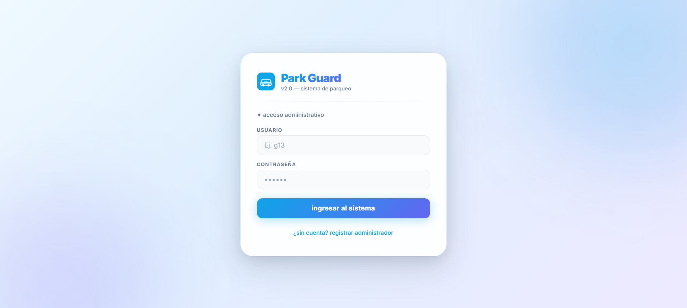
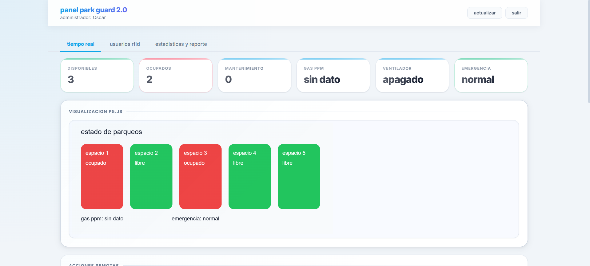
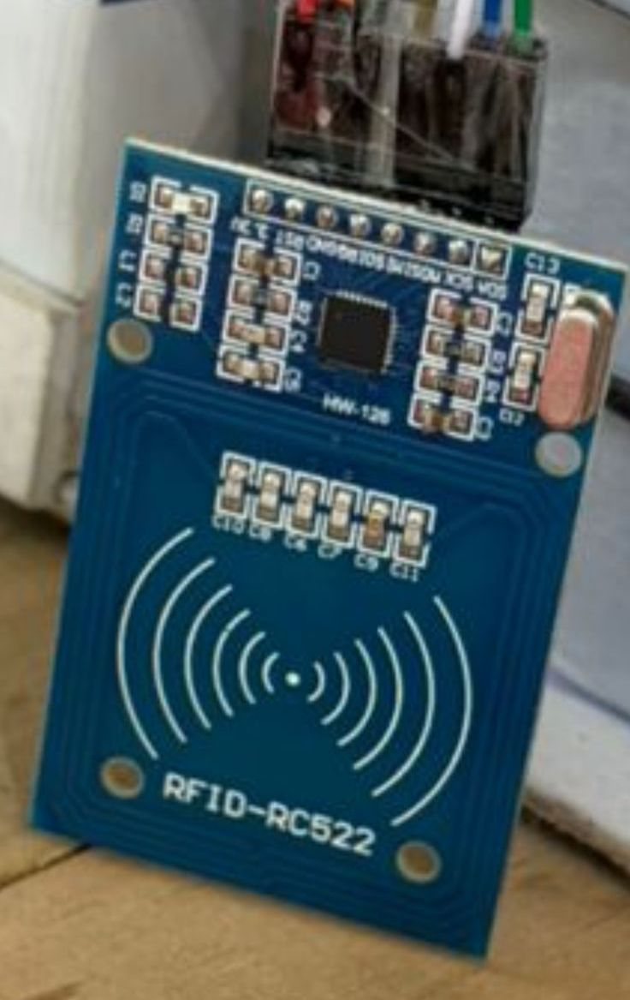
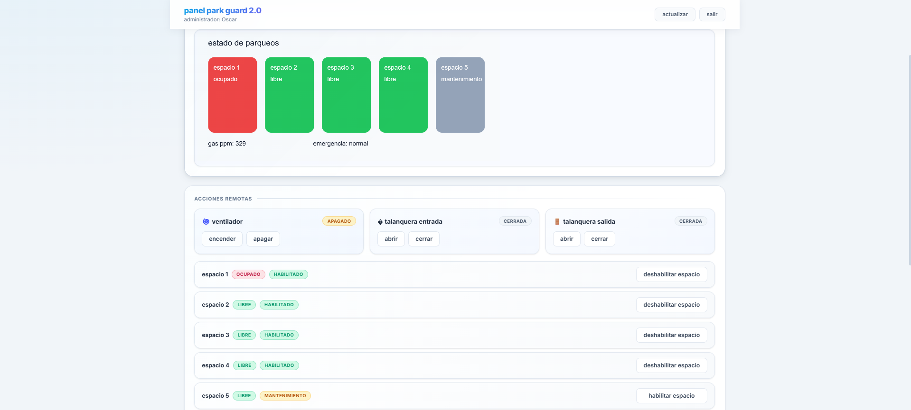
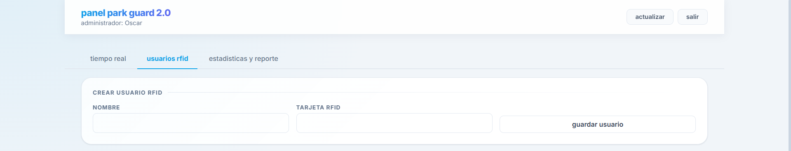
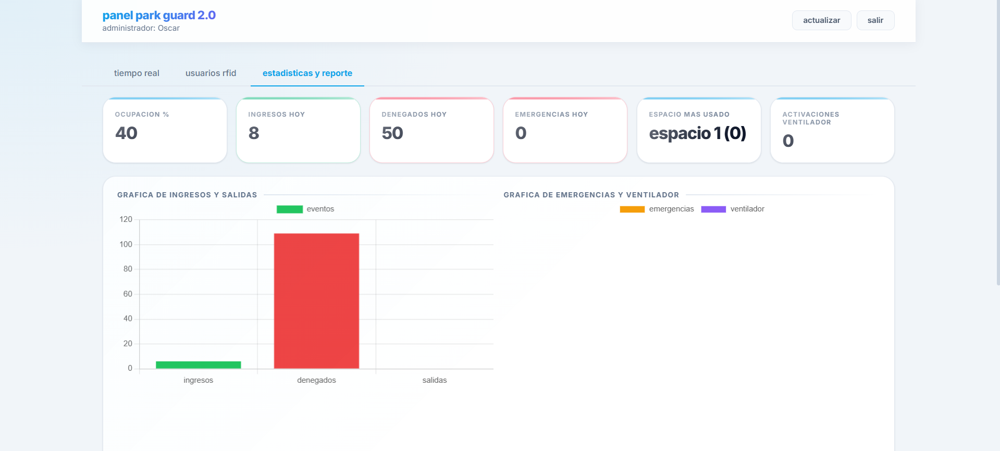
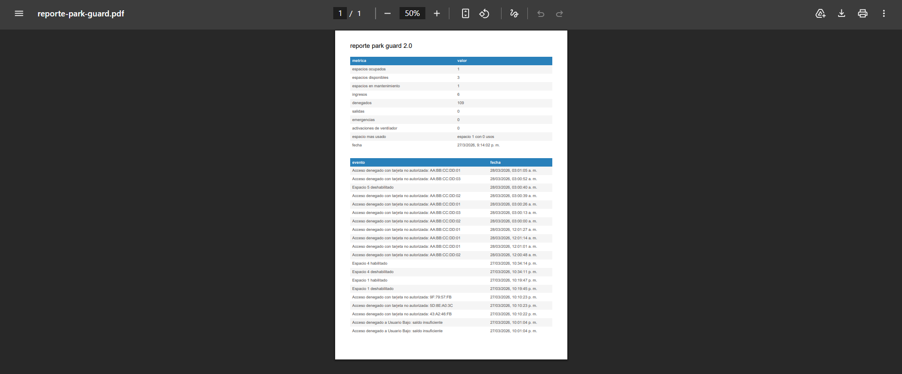

# Manual de Usuario
# Park-Guard 2.0

**Curso:** Arquitectura de Computadoras y Ensambladores 2  
**Ingeniero:** Gabriel Alejandro Diaz Lopez  
**Auxiliar:** Samuel Isai Muñoz Pereira  
**Grupo:** 13  
**Fecha:** 28 Marzo 2026

### Integrantes

| No. | Nombre | Carnet |
|-----|--------|--------|
| 1   |Ottoniel Fabricio Vásquez Pineda|202307820|
| 2   |Pablo Daniel Velásquez Hernández|202302232|
| 3   |Pablo Roberto García Sanun|202300448|
| 4   |Héctor Antonio Cardona Cos|202307354|
| 5   |Oscar David Padilla Vásquez|202103250|
| 6   |Diego Eduardo España Vásquez|202307716|

---

## Tabla de Contenidos

1. [Introducción](#introducción)
2. [Requisitos del Sistema](#requisitos-del-sistema)
3. [Acceso al Sistema](#acceso-al-sistema)
4. [Interfaz Principal del Dashboard](#interfaz-principal-del-dashboard)
5. [Procedimientos de Acceso al Parqueo](#procedimientos-de-acceso-al-parqueo)
6. [Monitoreo en Tiempo Real](#monitoreo-en-tiempo-real)
7. [Gestión de Usuarios (Administrador)](#gestión-de-usuarios-administrador)
8. [Estadísticas y Reportes](#estadísticas-y-reportes)
9. [Solución de Problemas](#solución-de-problemas)
10. [Preguntas Frecuentes](#preguntas-frecuentes)

---

## 1. Introducción

Bienvenido a **Park-Guard 2.0**, una plataforma inteligente de gestión de parqueos. Este manual le guiará a través de todas las funciones disponibles para usuarios, tanto residentes como administradores.

El sistema funciona de manera simple e intuitiva:

1. **Acceso Rápido:** Acerque su tarjeta RFID al sensor
2. **Validación Automática:** El sistema verifica su identidad
3. **Control de Acceso:** La barra se abre automáticamente si está autorizado
4. **Monitoreo:** Vea el estado del parqueo en tiempo real desde cualquier dispositivo

---

## 2. Requisitos del Sistema

### Para Acceder al Dashboard:

- **Navegador Web:** Chrome, Firefox, Safari o Edge (versiones recientes)
- **Conexión a Internet:** Conexión estable a la red del parqueo o Internet público
- **Dispositivo:** Computadora, tablet o smartphone
- **Credenciales:** Usuario y contraseña proporcionados por el administrador

### Para Acceder Físicamente:

- **Tarjeta RFID:** Tarjeta de acceso asignada por el parqueo
- **Vehículo Registrado:** Debe estar registrado en el sistema

---

## 3. Acceso al Sistema

### Paso 1: Abrir el Dashboard

1. Abra su navegador web
2. Escriba la dirección: `http://localhost:3000` (o la IP proporcionada por el administrador)
3. Verá la pantalla de login

### Paso 2: Ingresar Credenciales

1. Complete el campo **Email** con su correo registrado
2. Complete el campo **Contraseña** con su contraseña
3. Haga clic en el botón **INGRESAR**

### Paso 3: Validación

El sistema validará sus credenciales:
- Credenciales correctas, será redirigido al Dashboard
- Credenciales incorrectas, verá un mensaje de error

---

## 4. Interfaz Principal del Dashboard

Una vez logueado, verá la interfaz principal con los siguientes elementos:

### Elementos del Dashboard:

| Elemento | Descripción |
|----------|-------------|
| **Barra de Navegación** | Menú principal para acceder a diferentes secciones |
| **Panel de Bienvenida** | Muestra su nombre y hora de acceso |
| **Estado del Parqueo** | Espacios libres, nivel de gas y estado del ventilador |
| **Gráfica de Ocupación** | Visualización en tiempo real de cada espacio |

---

## 5. Procedimientos de Acceso al Parqueo

### Ingreso de Vehículo

#### Paso 1: Acercamiento al Sensor RFID

1. Conduzca hasta la entrada del parqueo
2. Localice el sensor RFID (típicamente en una garita o cabina)
3. Acerque su tarjeta RFID al sensor a una distancia de **3-5 cm**

#### Paso 2: Lectura y Validación

El sistema realizará automáticamente:
- Lectura de su tarjeta RFID
- Validación de su identidad en la base de datos
- Verificación de estado de cuenta (pagos al día, autorización vigente)

#### Paso 3: Apertura de Barrera

Si todo es correcto:
- La barrera se abre automáticamente
- La barrera permanece abierta 5 segundos para su paso

#### Paso 4: Acceso Denegado

Si la validación falla, verá:
- Barrera permanece cerrada
- Acceso denegado

---

## 6. Monitoreo en Tiempo Real

### Ocupación de Espacios

En esta sección podrá:

1. **Visualización Gráfica:** Ver en tiempo real qué espacios están ocupados y cuáles libres

### Monitoreo de Gas y Ventilación

En el panel superior, verá en tiempo real:

---

## 7. Gestión de Usuarios

### Acceso a Gestión de Usuarios

Solo usuarios con rol **Administrador** podrán acceder.

1. Haga clic en **"usuarios rfid"** en la barra de navegación

### Funciones Disponibles:

#### 1. Ver Usuarios Registrados

Verá una tabla con:
- Nombre del usuario
- Tarjeta RFID asignada
- Estado (Activo/Inactivo)
- Saldo
- Accesos
- Opciones para modificar al usuario
   - Editar
   - Activar / Desactivar
   - Saldo
   - Historial
   - Eliminar

#### 2. Registrar Nuevo Usuario

Llene los espacios para registrar a un nuevo usuario.

#### 3. Editar Usuario

Haga clic en el botón **"Editar"** junto al usuario

Podrá modificar:
- Nombre
- Email
- Teléfono
- Estado de cuenta

#### 4. Activar / Desactivar Usuario

Haga clic en el botón **"Activar / Desactivar"** junto al usuario

#### 5. Historial del usuario

Se puede ver la informacion por la cual el usuario tuvo acceso o no tuvo acceso.

---

## 8. Estadísticas y Reportes

### Acceso a Estadísticas

1. Haga clic en la pestaña **"Estadistica y Reporte"** en la barra de navegación

### Métricas Disponibles:

#### Flujo de Vehículos

- Opupación %
- Total de ingresos hoy
- Total de accesos denegados hoy
- Emergencias hoy
- Espacio mas usado
- Activaciones de ventilador

### Descargar Reportes

Haga clic en el botón **"Descargar PDF"**

El sistema generará un reporte completo con:
- Resumen ejecutivo con
- Listado de eventos

---

## 9. Solución de Problemas

### Problema: No puedo ingresar al Dashboard

**Posibles causas:**

1. **Credenciales incorrectas**
   - Verifique que el usuario y contraseña sean correctos
   - Las contraseñas distinguen mayúsculas de minúsculas

2. **Sin conexión a Internet**
   - Verifique su conexión de red
   - Intente reconectar al WiFi
   - Contacte al administrador si persiste

3. **Navegador incompatible**
   - Use Chrome, Firefox, Safari o Edge versiones recientes
   - Borre la caché del navegador y vuelva a intentar

### Problema: La barrera no abre

**Posibles causas:**

1. **Tarjeta no reconocida**
   - Acerque la tarjeta más al sensor (3-5 cm)
   - Intente nuevamente en 5 segundos
   - Verifique que la tarjeta no esté dañada

2. **Acceso denegado**
   - Verifique pagos pendientes
   - Revise si su autorización está vigente
