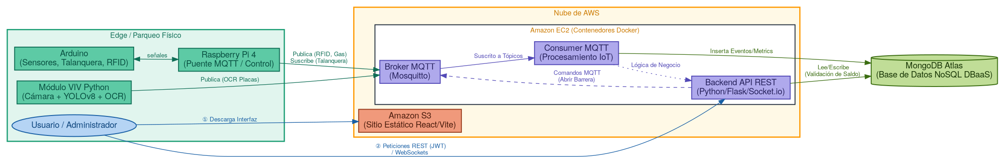
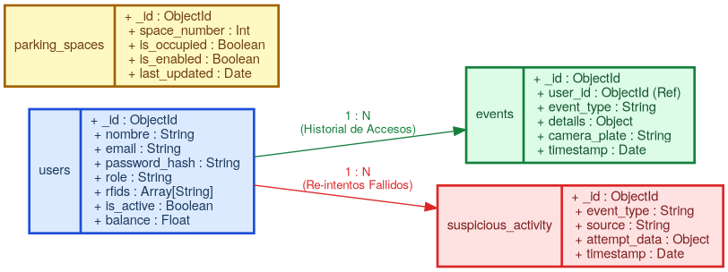
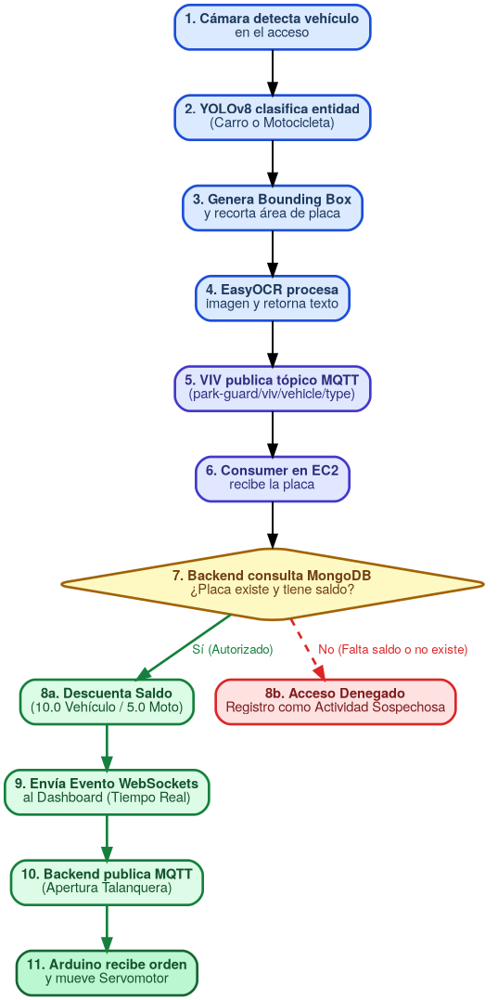

# Manual Técnico
# Park-Guard 3.0

**Curso:** Arquitectura de Computadoras y Ensambladores 2  
**Ingeniero:** Gabriel Alejandro Diaz Lopez  
**Auxiliar:** Samuel Isai Muñoz Pereira  
**Grupo:** 13  
**Fecha:** 1 Mayo 2026

### Integrantes

| No. | Nombre | Carnet |
|-----|--------|--------|
| 1   |Ottoniel Fabricio Vásquez Pineda|202307820|
| 2   |Pablo Daniel Velásquez Hernández|202302232|
| 3   |Pablo Roberto García Sanun|202300448|
| 4   |Héctor Antonio Cardona Cos|202307354|
| 5   |Oscar David Padilla Vásquez|202103250|
| 6   |Diego Eduardo España Vásquez|202307716|

---

## Tabla de Contenidos
1. [Arquitectura del Sistema (AWS)](#1-arquitectura-del-sistema-aws)
2. [Flujo de Comunicación y Protocolos](#2-flujo-de-comunicación-y-protocolos)
3. [Diseño de la Base de Datos](#3-diseño-de-la-base-de-datos)
4. [Módulo de Inteligencia Artificial (VIV)](#4-módulo-de-inteligencia-artificial-viv)
5. [Seguridad y Flujo JWT](#5-seguridad-y-flujo-jwt)
6. [Despliegue y Monitorización](#6-despliegue-y-monitorización)
7. [Diagramas Sugeridos](#7-diagramas-sugeridos)

---

## 1. Arquitectura del Sistema (AWS)
El sistema **Park-Guard 3.0** adopta una arquitectura orientada a eventos y microservicios, desplegada totalmente en infraestructura Cloud (AWS).

* **Frontend (Amazon S3):** La aplicación cliente desarrollada en React (Vite) se compila en un build estático y se aloja en un bucket de S3 ("Static Website Hosting"). Esto garantiza alta disponibilidad y rápida distribución de los Dashboards Web.
* **Backend y Broker MQTT (Amazon EC2):** Instancia EC2 que orquesta el Broker Mosquitto (gestión de hardware/IoT) y la API Backend (Python) empaquetados en contenedores Docker. Opera como el principal intermediario de mensajes bidireccionales y expone Endpoints Restful protegidos para el frontend.
* **Base de Datos (MongoDB Atlas):** El motor NoSQL se delega a un modelo DBaaS (Database as a Service) en MongoDB Atlas. Permite resiliencia, clustering automático georreferenciado, y escalabilidad de datos completamente desacoplada de nuestra capa de cómputo EC2.

## 2. Flujo de Comunicación y Protocolos
La interoperabilidad entre la infraestructura física (Arduino, sensores MQTT) y AWS se desarrolla mediante el protocolo **MQTT** para telemetría de baja latencia. El backend en EC2 consume estos eventos y los retransmite a la web mediante **WebSockets** (Socket.IO) logrando el monitoreo real-time.

### Tópicos MQTT Principales
| Tópico MQTT | Dirección | Carga Útil (Payload JSON) | Función |
|-------------|-----------|---------------------------|---------|
| park-guard/parking/+/status | HW -> Backend | {"space_number": 1, "is_occupied": true, "timestamp": "..."} | Reporta cambios de estado (libre/ocupado) en plazas individuales. |
| park-guard/gas/sensor | HW -> Backend | {"ppm": 350, "status": "normal"} | Reporte de concentración de gas MQ2 ambiental. |
| park-guard/ventilator/command| Web -> HW | {"is_active": true, "gas_level": 350} | Comando para encendido/apagado remoto de ventilación industrial. |
| park-guard/emergency/trigger | HW/Web -> All | {"type": "emergency", "is_active": true} | Alerta general de evacuación para apertura total y notificaciones. |
| park-guard/rfid/read | HW -> Backend | {"uid": "A1B2C3D4"} | Envío de lectura del tag físico (Tarjeta) para validación de ingresos/cobros en BD. |
| park-guard/viv/vehicle/type | VIV -> Backend| {"event_type": "viv_vehicle_detected", "source": "viv", "plate": "JNU540"} | Notificación originada por el bloque IA indicando un reconocimiento exitoso OCR+YOLO. |

## 3. Diseño de la Base de Datos
Park-Guard 3.0 emplea **MongoDB Atlas**, cuyo modelo orientado a documentos (BSON) se alinea eficientemente con los Payloads JSON entrantes derivados vía MQTT.

* **Colección users:** Almacena perfiles administrativos y residentes. Contiene campos de autenticación (hash/salt) para el panel, saldos activos, tags de tarjetas RFID asignadas y el indicador booleano de operatividad.
* **Colección events (Logs de Acceso e Historial VIV):** Base temporal robusta que registra la serie de tiempo. Engloba tránsitos vehiculares (aprobaciones / negaciones), activaciones de alarmas automáticas y pagos procesados por OCR VIV o RFID.
* **Colección parking_spaces:** Controla el estado persistente y meta-información física de las áreas (is_occupied, is_enabled, last_updated). Define el estado de "recuperación" del Dashboard Web en recargas.
* **Colección suspicious_activity:** Genera un registro de seguridad al detectar múltiples re-intentos de un RFID inválido o anomalías anómalas en módulos de barrera perimetral.

## 4. Módulo de Inteligencia Artificial (VIV)
El **Visor Inteligente Vehicular (VIV)** orquesta la visión artificial Edge para evitar credenciales físicas. 

1. **Detección y Clasificación Continua (YOLOv8):** 
   Utiliza modelado ultra-ligero (yolov8n.pt) corriendo ciclo infinito para encontrar exclusivamente instancias vehiculares con alta resolución de confianza, catalogadas como car y motorcycle.
   `python
   results = model(frame)
   # ... itera sobre detections
   label = model.names[int(box.cls[0])]
   if label not in ["car", "motorcycle"] or confidence < YOLO_CONFIDENCE:
       continue
   `
2. **Extracción y Reconocimiento (OCR):**
   Una vez encapsulado el automotor, el software recorta una franja delimitadora inferida (donde idealmente reposa la matrícula), aplica escalado cúbico e invoca a **EasyOCR** con validación estricta alfanumérica.
   `python
   plate_roi = frame[plate_y1:plate_y2, plate_x1:plate_x2]
   results = reader.readtext(plate_roi, allowlist="ABCDEFGHIJKLMNOPQRSTUVWXYZ0123456789")
   `
3. **Delegación de Responsabilidad IoT:** 
   Confirmada la mejor lectura contra ruido fotográfico, el VIV empaqueta una encomienda MQTT (park-guard/viv/vehicle/type). En EC2, el backend buscará coincidencia de placa, deducirá tarifas jerarquizadas (10.0 carros / 5.0 motos) y disparará la orden de barrera (doors/entrance/status) para aperturar.

## 5. Seguridad y Flujo JWT
Las rutas REST del Backend EC2 exigen políticas rigurosas amparadas detrás de tokens **JWT** (JSON Web Token).
* **Autenticación (Login):** Intercambia credenciales contra users MongoDB. Si el password coincide frente a los hashes bcrypt, firma y emite un token con expiración programada, codificado con un secreto estricto de servidor (JWT_SECRET_KEY).
* **Protección de Endpoints:** Acciones Crud administrativas (ej. Registrar RFID, abonar saldo) delegan su ingreso a middlewares o decoradores (@token_required). Estas lógicas extraen la cabecera Authorization: Bearer <TOKEN> previniendo de toda manipulación ajena maliciosa en los Endpoints EC2.

## 6. Despliegue y Monitorización

### Orquestación de Stack en EC2 
El ambiente backend completo es transportable y empaquetado usando **Docker** y orquestado con docker-compose.yml.
El clúster virtualiza y lanza simétricamente al host en pocos pasos:
1. mqtt (Imagen eclipse-mosquitto con mosquitto.conf abierto al 1883 universal).
2. Backend (FastAPI / Flask / Socket.io) anclado de forma intrínseca a la DB Atlas y puente Broker, instalando 
equirements.txt.
3. consumer_mqtt Demonio persistente (CMD ["python", "consumer_mqtt.py"]) dedicado al log de métricas.

### Monitorización Analítica con Grafana
El proyecto anexa un dashboard robusto en **Grafana** (con provisionamiento automatizado vía plugins JSON de marcusolsson). 
* Utilizando peticiones a los endpoints REST de las métricas que operan Aggregation Pipelines nativos de MongoDB ($match, $group), traduce conteos de accesos VIV/RFID o picos de gas a paneles visuales dinámicos. 
* Ej: Los query de Tiempos/Series despliegan curvas diurnas visualizando qué sector presenta sobrecupo, y cruces entre *Accesos Exitosos* vs *Denegados* dictaminan la seguridad física del complejo a lo largo de las horas.

## 7. Diagramas Sugeridos

A continuación, se presentan los esquemas visuales creados en lenguaje **Graphviz (DOT)** para representar formalmente la infraestructura del proyecto.

### 7.1. Diagrama de Arquitectura Global (AWS)
Representación del despliegue en la nube, separando el Frontend en S3, Backend/Broker en EC2 y Base de Datos en Atlas.

### 7.2. Diagrama Entidad-Relación (NoSQL) de MongoDB
Estructura de documentos BSON y referencias lógicas.

### 7.3. Diagrama de Secuencia (VIV a Talanquera)
Flujo de datos desde la captura de imagen hasta la apertura de la barrera.

