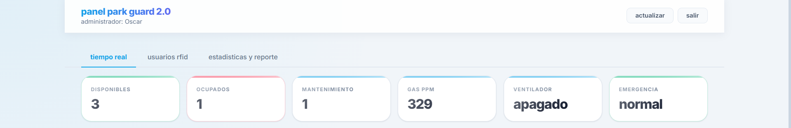
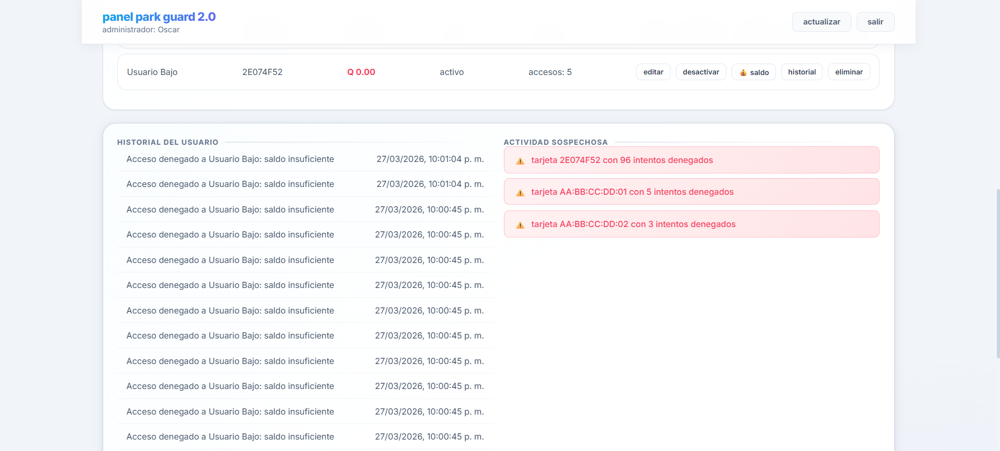
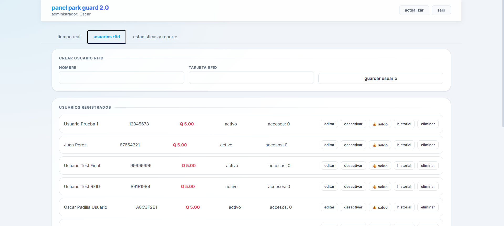
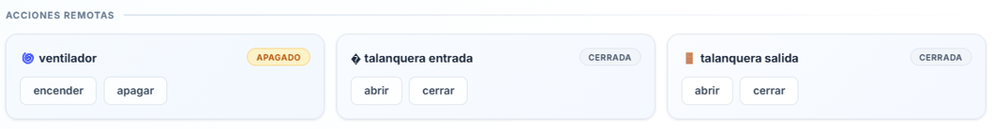
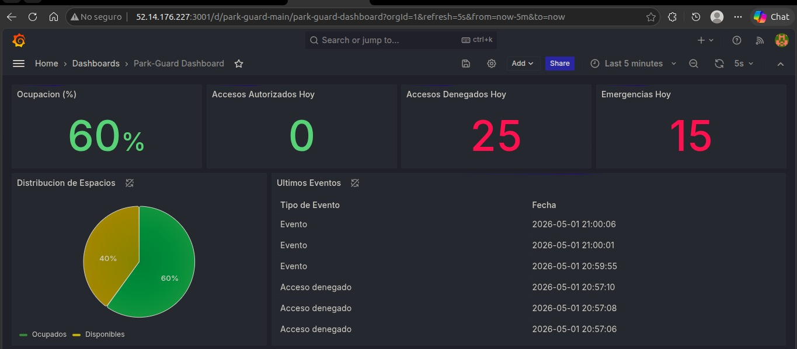
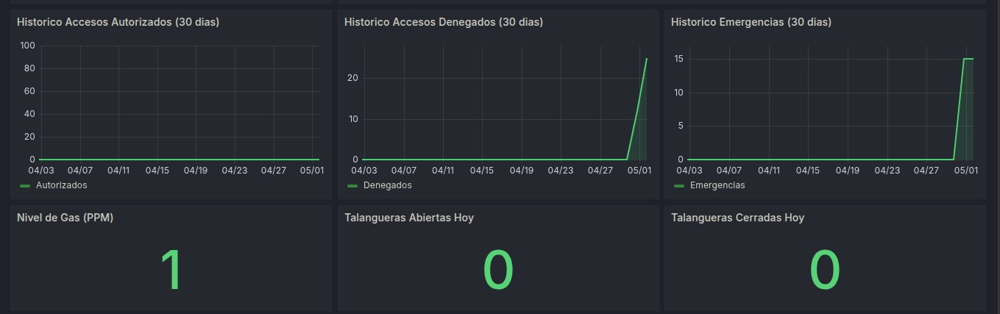
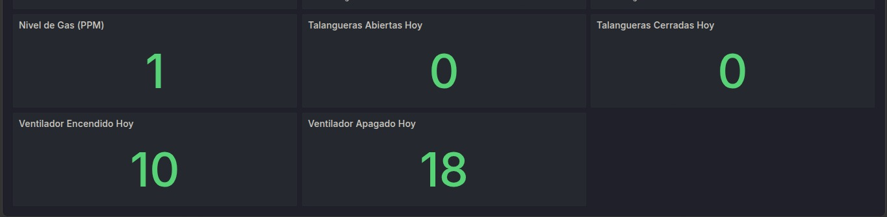
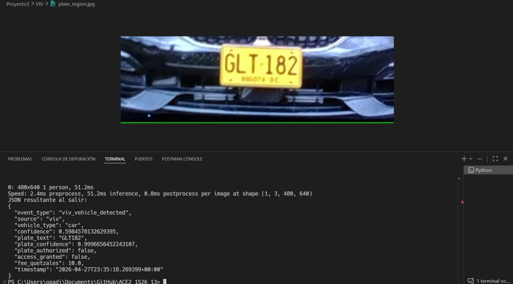

# Manual de Usuario
# Park-Guard 3.0

**Curso:** Arquitectura de Computadoras y Ensambladores 2  
**Ingeniero:** Gabriel Alejandro Diaz Lopez  
**Auxiliar:** Samuel Isai Muñoz Pereira  
**Grupo:** 13  
**Fecha:** 1 Mayo 2026

### Integrantes

| No. | Nombre | Carnet |
|-----|--------|--------|
| 1   |Ottoniel Fabricio Vásquez Pineda|202307820|
| 2   |Pablo Daniel Velásquez Hernández|202302232|
| 3   |Pablo Roberto García Sanun|202300448|
| 4   |Héctor Antonio Cardona Cos|202307354|
| 5   |Oscar David Padilla Vásquez|202103250|
| 6   |Diego Eduardo España Vásquez|202307716|

---

## Tabla de Contenidos

1. [Introducción y Acceso](#1-introducción-y-acceso)
2. [Requisitos del Sistema](#2-requisitos-del-sistema)
3. [Dashboards en Tiempo Real](#3-dashboards-en-tiempo-real)
4. [Gestión de Usuarios RFID](#4-gestión-de-usuarios-rfid)
5. [Monitoreo y Acciones Remotas](#5-monitoreo-y-acciones-remotas)
6. [Dashboard de Grafana](#6-dashboard-de-grafana)
7. [Operación del Módulo VIV](#7-operación-del-módulo-viv)
8. [Preguntas Frecuentes (FAQ)](#8-preguntas-frecuentes-faq)

---

## 1. Introducción y Acceso

Bienvenido a **Park-Guard 3.0**, la plataforma IoT y Cloud para gestión inteligente de parqueos. Esta nueva versión integra visión artificial y procesamiento en la nube usando AWS (EC2 y S3) junto con MongoDB Atlas, ofreciendo monitoreo instantáneo mediante el protocolo MQTT y WebSockets.

### Autenticación Segura (Login JWT)
El acceso al Dashboard Web requiere credenciales válidas. Todo el proceso está asegurado por tokens JWT (JSON Web Tokens) emitidos desde la nube para verificar su identidad continuamente.

1. Ingrese a la URL del frontend http://parkguard-grupo13.s3-website.us-east-2.amazonaws.com/panel 

2. Introduzca su **Correo Electrónico** y **Contraseña**.
3. Haga clic en **INGRESO SEGURO**.
4. Si las credenciales son válidas, accederá a la pestaña de "Tiempo Real"; de lo contrario, se mostrará un mensaje de error.

 

---

## 2. Requisitos del Sistema

### Para Acceder al Dashboard Web:

- **Navegador Web:** Chrome, Firefox, Safari o Edge (versiones recientes y con soporte para WebSockets).
- **Conexión a Internet:** Conexión estable a internet para acceder a la aplicación alojada en S3 y comunicarse con el backend en EC2.
- **Dispositivo:** Computadora, tablet o smartphone.
- **Credenciales:** Credenciales de usuario autorizadas y almacenadas en la base de datos MongoDB Atlas.

### Para el Acceso Físico en el Parqueo:

- **Tarjeta RFID:** Tarjeta RFID asignada y vinculada a un usuario activo.
- **Vehículo Registrado (VIV):** Para accesos automatizados con cámara, la placa del vehículo debe ser visible y registrada en la base de datos, cuidando de contar con saldo suficiente.

---

## 3. Dashboards en Tiempo Real

La interfaz principal ("Tiempo Real") le permite monitorear instantáneamente la ocupación del parqueo y el estado de la maqueta, gracias a comunicaciones bidireccionales vía MQTT/WebSockets.

 

### Panel de Ocupación
Visualice en vivo los espacios del parqueo:
* **Espacio Ocupado:** Resaltado en color rojo.
* **Espacio Libre:** Resaltado en color verde.
* Al acercar o alejar un vehículo a los sensores de la maqueta, el estado en pantalla cambiará en menos de un segundo.

### Estado de la Maqueta
La sección de métricas superiores muestra variables críticas del sistema físico:

 

 

 

| Sensor / Elemento | Descripción / Estados |
|-------------------|-----------------------|
| **Niveles de Gas (MQ2)** | Muestra la concentración actual en PPM (Partes por millón). |
| **Ventilador** | **Activo** / **Inactivo**. Responde a niveles altos de gas o activación remota. |
| **Barreras (Talanqueras)**| Indica si la entrada o salida está **Abierta** o **Cerrada**. |
| **Emergencia** | Alerta visual si se ha desencadenado una emergencia. |

---

## 4. Gestión de Usuarios RFID

El administrador posee control sobre el control de acceso desde la nube. En la pestaña **"Usuarios"**, la validación de RFID ocurre verificando los datos alojados en MongoDB Atlas.

 

### Administración de Tarjetas
* **Ver Usuarios:** Presenta un listado completo con Nombre, Tarjeta RFID, Rol, Estado Activo/Inactivo, y su **Saldo actual**.
* **Agregar y Editar:** Permite asignar una nueva tarjeta RFID a un usuario o modificar su información de contacto.
* **Recargas / Saldos:** Permite modificar el saldo que utilizan los usuarios para pagar la tarifa automática de ingreso/salida.
* **Historial RFID:** Visualice el historial de intentos (Aceptados y Denegados) asociados a esa tarjeta específica.

---

## 5. Monitoreo y Acciones Remotas

En el área de operaciones del Dashboard, Park-Guard 3.0 le permite enviar comandos al hardware desde cualquier parte del mundo utilizando los tópicos de control MQTT.

* **Activar/Desactivar Ventiladores:** Botones en la interfaz emiten diversos comandos (ej. park-guard/ventilator/command) para encender o apagar la extracción de aire a voluntad.
* **Alertas de Emergencia:** Puede declarar el estacionamiento en emergencia emitiendo comandos directos. Esto comunicará un estado de máxima alerta tanto en la web como en los componentes físicos del parqueo.
* **Control de Barreras:** Control vía backend para facilitar operaciones de mantenimiento.

---

## 6. Dashboard de Grafana

Grafana centraliza todas las **Métricas e Históricos**. El backend alimenta en tiempo real la información recolectada en MongoDB.
 
 

 

 

### Comprensión de las Métricas
1. **Accesos autorizados/denegados:** Gráficas detallando comprobaciones RFID y VIV exitosas versus accesos rechazados. Podrá detectar incidentes fácilmente.
2. **Frecuencia de eventos críticos:** Panel observando activaciones y alarmas de niveles altos de gas de manera cronológica.
3. **Patrones de uso y ocupación histórica:** Gráficas de comportamiento detallando las horas o días más transitados del parqueo.

---

## 7. Operación del Módulo VIV

Park-Guard 3.0 integra un avanzado módulo de **Visión Inteligente Vehicular (VIV)** a través de una cámara para automatizar accesos.

1. **Detección Automática y Clasificación:** El sistema captura video en vivo y utiliza YOLOv8 para clasificar entre **Carro** o **Motocicleta**.
2. **Reconocimiento Óptico de Placas (OCR):** Recorta el área inferior de la caja delimitadora del vehículo y extrae el texto (letras y números) correspondiente a la placa usando EasyOCR.
3. **Validación Autorizada:** Verifica que la matrícula esté dentro de la base de datos (MongoDB).
4. **Tarifas y Saldos Automáticos:** 
   * **Carros:** El sistema cobra una tarifa plana configurada (ej. 10.0 unidades).
   * **Motocicletas:** Se cobra una tarifa reducida (ej. 5.0 unidades).
   * Si la placa se valida con éxito, notifica al backend vía MQTT (park-guard/viv/vehicle/type) ordenando acceso autorizado y descuenta el saldo.

---

## 8. Preguntas Frecuentes (FAQ)

**El Panel en Tiempo Real no muestra cambios en los componentes, ¿qué ocurre?**
* Puede tratarse de una interrupción de **MQTT**. Verifique que la placa (Arduino/Raspberry Pi) esté correctamente conectada al Wi-Fi, el consumer_mqtt backend corriendo, y que los archivos .env (Frontend y Backend) apunten al mismo host/puerto del Broker MQTT en EC2.

**¿Por qué el Sistema VIV deniega el acceso a una placa existente?**
* Existen errores de falso reconocimiento bajo mala iluminación. Evite brillos excesivos en el área del lente, asegúrese de que la cámara capte al auto centrado y limpie su respectiva lente de acercamiento.

**Realizo una "Activación de Emergencia" web, pero el físico no reacciona.**
* Confirme que el tópico MQTT exacto esté suscrito por su cliente Arduino y que la señal de internet siga abierta en el entorno local del Maker.

**Error de inicio de sesión "Acceso Denegado".**
* Revise que el servicio de backend con MongoDB local o en Atlas se encuentre en línea, para de esta manera recuperar la base de datos y validar el JWT asociado a sus credenciales de manera exitosa.
